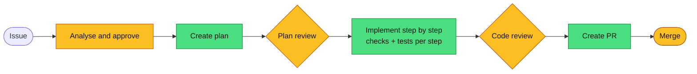

# MCP Coder

**Turn GitHub issues into reviewed pull requests with a staged, LLM-driven process: full control and visibility, and you only write the issues.**

[](https://github.com/MarcusJellinghaus/mcp_coder/actions/workflows/ci.yml) [](https://pypi.org/project/mcp-coder/) [](https://pypi.org/project/mcp-coder/) [](LICENSE)

Every change to MCP Coder itself passes these checks ([details](docs/repository-setup/quality-and-security-checks.md)):

[](https://github.com/astral-sh/ruff) [](https://mypy.readthedocs.io/) [](https://github.com/pylint-dev/pylint) [](docs/architecture/enforcement.md) [](https://github.com/MarcusJellinghaus/mcp_coder/actions/workflows/ci.yml) [](https://scorecard.dev/viewer/?uri=github.com/MarcusJellinghaus/mcp_coder) [](https://github.com/MarcusJellinghaus/mcp_coder/actions/workflows/github-code-scanning/codeql)

## What it does

- **Minimal input.** You write and refine issues, approve at the review gates and merge. Everything else can run unattended; failures come back to you as labelled issues.
- **Control and visibility.** Each stage ends in a written hand-over document: the refined issue, the plan, step files, commits, review comments. You can inspect or correct at every point.
- **Quality gates on every step.** pylint, mypy and pytest run after each implementation step, and each step is followed by a dedicated unit-test step. Tests are part of the review.
- **Fewer tokens, shorter conversations.** Instead of one large implementation conversation, the work is split into small steps, each starting with a fresh context and only the hand-over documents it needs. This should reduce token consumption.

## Why a structured process

Spec-driven development, applied to GitHub issues:

`issue → refined spec → reviewed plan → implementation in small verified steps → reviewed code → PR`

- A GitHub status label on the issue is the only workflow state. It decides what runs next.
- Plan and code review are explicit approval points. You can do them interactively, or enable an optional automated review that hands over to you when it needs a human.
- The LLM does the creative work; MCP Coder owns the process around it and verifies the result itself instead of trusting it.
- Unattended runs are driven by `mcp-coder coordinator`, which polls issues and starts workflows, typically on Jenkins.



Yellow: you, usually in an interactive LLM session. Green: automated by `mcp-coder`. Full state machine, labels and failure handling: [Development Process](docs/processes-prompts/development-process.md).

## Status and scope

| Level | What |
|---|---|
| Works well | Python projects, GitHub, Claude Code |
| Experimental | GitHub Copilot CLI, LangChain backends (OpenAI, Gemini, Anthropic API, Ollama, …) |
| Prototype | `iCoder`, an alternative interactive terminal interface |
| Planned | Other programming languages, general LLM support |

The label-driven process itself is language-agnostic. Python is the supported target for now because `implement`, the installer and the architecture checks call Python tools. GitHub is the only supported forge.

## Quick start

Requirements: Python 3.11+, Git, a GitHub-hosted repository and [Claude Code CLI](https://code.claude.com/docs) (recommended; [Copilot CLI](https://docs.github.com/copilot/how-tos/use-copilot-agents/use-copilot-cli) is experimental).

```bash
pip install mcp-coder
```

Set up your repository once ([Repository Setup](docs/repository-setup/README.md), [Label Setup](docs/getting-started/label-setup.md)), then run the stages against it:

```bash
mcp-coder create-plan --project-dir <repo> <issue-number>
mcp-coder implement   --project-dir <repo>
mcp-coder create-pr   --project-dir <repo>
```

In practice the [coordinator](docs/coordinator-vscodeclaude.md) runs these stages for you as the issue's status label advances. Other install paths (editable dev install, pinned GitHub ref, separate environment): [Installation Guide](docs/getting-started/installation.md). All commands: [CLI Reference](docs/cli-reference.md).

## Documentation

- [Development Process](docs/processes-prompts/development-process.md): stages, labels, slash commands, failure handling
- [Repository Setup](docs/repository-setup/README.md): labels, GitHub Actions, MCP configuration, Jenkins
- [CLI Reference](docs/cli-reference.md) and [Configuration](docs/configuration/config.md)
- [Architecture](docs/architecture/architecture.md) and [why it is enforced](docs/architecture/enforcement.md)
- [Full documentation index](docs/README.md)

## Related projects

- [mcp-tools-py](https://github.com/MarcusJellinghaus/mcp-tools-py): code quality MCP server
- [mcp-workspace](https://github.com/MarcusJellinghaus/mcp-workspace): file system and GitHub MCP server
- [mcp-coder-utils](https://github.com/MarcusJellinghaus/mcp-coder-utils): shared subprocess, logging and redaction helpers
- [AutoRunner](https://github.com/MarcusJellinghaus/AutoRunner): Jenkins infrastructure for unattended runs

## Security and license

Report vulnerabilities as described in [SECURITY.md](SECURITY.md). Released under the terms in [LICENSE](LICENSE).
