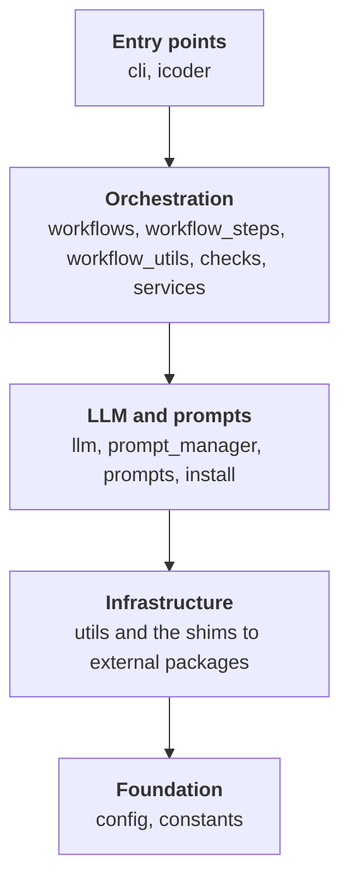

# MCP Coder Architecture

Overview following the [arc42](https://arc42.org) structure. It holds what stays true while the code changes: purpose, structure, rules, and the reasons behind them. For module and function detail, read the code and its docstrings. Rules are enforced by tooling, see [enforcement.md](enforcement.md).

---

## 1. Introduction and Goals

`mcp-coder` is a CLI and workflow orchestrator for LLM sessions. It drives a GitHub issue from planning through implementation and review to a pull request. The LLM does the creative work; mcp-coder owns the process around it. The label-driven workflow itself is language-agnostic, but Python is the supported ecosystem for now: `implement` calls Python tools directly (mypy, the formatter), and the installer and architecture enforcement assume a Python target repo. GitHub is the only supported forge.

**Quality goals**

1. **Safe to change with partial context.** An LLM (or human) editing one module cannot break the architecture by accident; boundaries fail in CI.
2. **Open to other LLMs.** Claude Code is the primary backend and the one the workflows are exercised with. Copilot CLI and LangChain providers (OpenAI, Gemini, Anthropic API, Ollama) sit behind the same interface so that others can be adopted without touching callers.
3. **Reproducible automation.** Workflows run the same locally, on a build server and in headless sessions.
4. **Humans decide at the gates.** Plan and code review are explicit approval points. Automated review is optional and config-gated.

**Stakeholders:** developers using the workflow, the LLM acting as worker, and teams automating issue handling.

---

## 2. Constraints

- Python 3.11+; Claude Code CLI is the expected backend. Copilot CLI or a LangChain backend can replace it.
- GitHub only. Issues, labels, PRs and CI status are GitHub concepts reached through `mcp-workspace`; GitLab and others are not supported, and there is no forge abstraction beyond the shim.
- Target repos are Python projects for now. The `implement` workflow calls mypy and the formatter directly; Pylint, pytest and the import-layer checks come from `mcp-tools-py` via the LLM; and `mcp-coder install` provisions a Python venv. The setup guides separate general files from Python-only ones ([repository-setup](../repository-setup/README.md)), which is where other languages would plug in.
- Git and GitHub access goes through the external `mcp-workspace` package; code-quality tools come from `mcp-tools-py`. Shared subprocess, logging and redaction helpers come from `mcp-coder-utils`. All three are reached only through local shim modules.
- GitHub labels are the workflow state machine, so the label set is a hard dependency. See [Development Process](../processes-prompts/development-process.md).
- Dependency versions and tool configuration live in `pyproject.toml`.

---

## 3. Context and Scope

```
┌────────┐   ┌────────────┐   ┌──────────────────┐   ┌─────────────────┐
│ GitHub │◄─►│ mcp-coder  │◄─►│ LLM backend      │◄─►│ MCP servers     │
│ issues │   │ orchestra- │   │ Claude Code      │   │ mcp-workspace   │
│ labels │   │ tion       │   │ (+ other LLMs)   │   │ mcp-tools-py    │
│ PRs    │   │            │   │                  │   │                 │
└────────┘   └────────────┘   └──────────────────┘   └─────────────────┘
```

- **GitHub** triggers work (status labels) and receives results (comments, labels, PRs).
- **mcp-coder** decides what runs next, prepares context and records results.
- **The LLM backend** reasons and writes: plans, code, reviews, PR text. Today that is Claude Code; other providers are supported through the same interface.
- **MCP servers** give the LLM file access and quality checks. The LLM talks to them directly; mcp-coder configures them and, for a few steps (mypy, formatting), calls the same Python tools itself.
- **Target repos** are the (currently Python) repositories mcp-coder works on. mcp-coder is installed once and pointed at them with `--project-dir`; it is not part of their code. A target repo supplies its own `.mcp.json` and `.claude/`, declares install extras and sibling pins in its `pyproject.toml`, and carries the status labels. `mcp-coder init` deploys skills, agents and the knowledge base into it. The contract is checked at launch; see [repository-setup](../repository-setup/README.md#target-repo-contracts). This file doubles as a model: `/implementation_review` expects each target repo to have its own `docs/architecture/architecture.md`.

---

## 4. Solution Strategy

- **Label-driven state machine.** The issue's `status-NN:*` label is the only workflow state. It selects the workflow to run; the workflow moves the label on success or failure, so no local state decides what happens next. Labels are defined in `src/mcp_coder/config/labels.json` (overridable per repo) and synced with `mcp-coder gh-tool define-labels`. That file also marks which labels are promotable by `/approve` and which are failures. Three families:
  - **Main flow (01-10):** created → planning → implementing → PR created, with in-progress labels (03, 06, 09) and `f` failure variants.
  - **Optional bot review (14, 17):** used only when automated review is enabled.
  - **PR health (71-74, 81-84, 91):** the coordinator checks open PRs on every poll and routes conflicts, failing CI and review comments back to a workflow or a human.

  Diagram and per-label behaviour: [Development Process](../processes-prompts/development-process.md). Setup: [Label Setup](../getting-started/label-setup.md).
- **Orchestrator vs. worker.** mcp-coder supplies context and consumes results; the LLM creates content and uses tools. The orchestrator also verifies the LLM's work itself instead of trusting it. Today `implement` re-runs mypy itself once after all tasks, with LLM fix attempts (`[tool.mcp-coder.implement] check_type_hints`, on by default), and the commit step runs the formatter (`format_code`, on by default), both Python tools called through the `mcp_tools_py` shim. The LLM also runs pylint, pytest and mypy during each task, as its prompt tells it to.
- **One LLM interface, Claude Code first.** Callers use `llm.interface`; provider specifics stay in `llm/providers/`. Claude Code is the primary provider and drives the design (project-dir anchoring, session logs, MCP configuration). Other providers are kept working behind the same interface but are less exercised.
- **Thin top, reusable bottom.** Workflows only sequence; composed steps and primitives sit below and are shared (see section 5).
- **Architecture is enforced, not just described.** Layers, sibling independence and library wrappers are CI checks.
- **Optional features degrade silently.** LangChain, MLflow and the TUI work without their extras installed.
- **Anchor the LLM subprocess to `project_dir`.** Claude Code finds `CLAUDE.md` and settings by walking up from its working directory, and no flag overrides that. So the working directory decides whose rules the agent obeys. On a build server the shell sits in the tool environment, not the checkout, and runs picked up a stale project's rules (#1113). The subprocess therefore starts in `project_dir`; other layouts are supported explicitly through `--project-dir`, `--mcp-config` and `--settings`. Same pattern as #977 and #981. Trade-off: a project can no longer inherit a `.mcp.json` from a shared workspace through cwd discovery. Each run reports which instruction files it found and warns when none lies inside `project_dir`.

---

## 5. Building Block View

Dependencies point downward only: a band may import the bands below it, never above.



Inside the orchestration band the order is also fixed: `workflows` on top, then `workflow_steps`, then the primitives (`workflow_utils`, `checks`, `services`). The exact layer order is the `layered_architecture` contract in [`.importlinter`](../../.importlinter), with the layers in [`tach.toml`](../../tach.toml).

| Block | Responsibility |
|-------|----------------|
| `cli` | Argument parsing and command routing. Commands are thin and one per file. |
| `icoder` | Interactive terminal chat. Logic lives in a Textual-free core; the UI is a thin shell, which keeps it testable. |
| `workflows` | `implement`, `create_plan`, `create_pr`, `fix_ci`, `fix_conflict`, `review`, `vscodeclaude`. Each owns its labels, config and failure categories. |
| `workflow_steps`, `workflow_utils`, `checks`, `services` | Reusable pieces under the workflows. Primitives never import upward. |
| `llm` | One interface over Claude Code CLI (primary), Copilot CLI and LangChain. Owns streaming, session storage and logging of LLM calls. |
| `prompts`, `prompt_manager` | Prompt templates and the system and project prompts layered on them. |
| `install` | Provisions a target environment for `mcp-coder install`. Reads policy from the target's `pyproject.toml`. |
| `utils` | Technical helpers and shims for shared libraries. |
| shims | Single entry points to external packages: `mcp_workspace_git`, `mcp_workspace_github`, `mcp_tools_py`. |
| `config`, `constants` | Foundation. No internal dependencies. |

For module and function detail, read the module docstrings and the code. Each module's first docstring line states its responsibility.

---

## 6. Runtime View

The default path through the issue lifecycle. Each step is one workflow run, triggered by a label. With `auto_review_plan` / `auto_review_implementation` on, an automated review runs between steps. Label names and failure branches: [Development Process](../processes-prompts/development-process.md).

1. **Plan.** `create-plan` reads the issue and codebase through the LLM, posts the plan, and moves to plan review.
2. **Implement.** After plan approval, `implement` loops over plan tasks: the LLM edits and runs checks, mcp-coder formats, commits and pushes, and after the last task runs a final mypy pass. An agent that cannot verify its work writes `pr_info/.blocked.txt` and the run fails to a blocked label.
3. **Pull request.** After code approval, `create-pr` writes the PR, checks mergeability and waits for CI. `fix-conflict` and `fix-ci` handle the failure branches.
4. **Review feedback.** PR comments, conflicts and failing CI route back to an interactive or automated session.

A project can be driven from any directory with `--project-dir`; see the execution-context decision in section 4.

---

## 7. Deployment View

- **Developer machine.** `mcp-coder` runs in its own tool environment; the target project has its own `.venv`, `.claude/` and `.mcp.json`. User settings are in `~/.mcp_coder/config.toml`.
- **Automated runs (coordinator + Jenkins).** Jenkins is an executor, not a build server. The infrastructure (Jenkins master, agents, job definitions as a shared library) lives outside this repository. The two meet at the job parameters.
  - A coordinator job runs `mcp-coder coordinator --all` every minute. It finds issues in a trigger label and starts the executor job once per issue, passing a `COMMAND` script generated from a template in mcp-coder.
  - The executor job checks out the repo, provisions the project's venv with `mcp-coder install`, and runs the `COMMAND`, which is one workflow call such as `mcp-coder implement --project-dir <checkout>`. A watchdog step in the template moves the issue to a failure label if the run died without setting one, so issues cannot sit at an in-progress label.
  - **Two environments.** A shared *tool* environment holds mcp-coder and the MCP servers. Each job also gets a *project* environment inside the checkout. The shell sits in the tool environment, the checkout elsewhere, so `--project-dir` is always explicit. See [environments](../environments/environments.md).
  - A separate job rebuilds the tool environment. Jenkins lockable resources keep it from running while executors use that environment.
  - Agents are Windows or container-based. Jenkins-side permissions and credentials: [jenkins.md](../repository-setup/jenkins.md).
- **Interactive sessions (VSCodeClaude).** `mcp-coder vscodeclaude launch` opens VS Code with a Claude session for issues that need human action. `mcp-coder install` provisions the session environment.
- **Provisioning.** `mcp-coder install` creates `<target>/.venv` and installs mcp-coder from git, PyPI or a local checkout. Staging `.mcp.json` and `.claude/` is the caller's job.
- **Release to other users.** Publishing a GitHub release triggers a workflow that builds the package (version from git tags via setuptools-scm) and publishes it to PyPI through trusted publishing, then attaches signed artifacts to the release. Users install with `pip` or `uv`; extras such as `langchain` are optional.

Setup details: [repository-setup](../repository-setup/README.md), [environments](../environments/environments.md), [coordinator and VSCodeClaude](../coordinator-vscodeclaude.md).

---

## 8. Crosscutting Concepts

- **Boundaries and shims.** One module owns each external library, and git and GitHub are reached only through shims. Why and how: [enforcement.md](enforcement.md).
- **Logging.** Set up centrally. INFO is reserved for workflow status; LLM request, response and error detail is DEBUG. Each Claude run is also captured as an NDJSON session log for post-mortems.
- **Configuration.** User settings in `~/.mcp_coder/config.toml`, project rules in `.claude/CLAUDE.md`. Secrets come from the environment, never from committed files. See [config](../configuration/config.md).
- **Sessions.** Claude keeps conversation history server-side. LangChain history is stored locally by mcp-coder and guarded: resuming an unknown session id is an error, never a silent blank conversation. A turn that stored nothing returns no session id, and callers must handle that.
- **Optional features.** LangChain, MLflow and the TUI are extras. Absent extras must not break import or the default path. See [optional dependencies](../configuration/optional-dependencies.md).
- **MLflow tracking.** When enabled in `config.toml`, every LLM call made through `llm.interface` is logged to MLflow (duration, tokens, cost, model, branch, full conversation). Because the hook sits in the interface, it covers all providers. The logger falls back silently if MLflow is missing. `mcp-coder verify` reports its state. Details: [MLflow integration](../configuration/mlflow-integration.md).
- **Quality gates.** pylint, pytest and mypy must pass after every change, run through the MCP tools. The CI matrix runs each check as an independent job. What runs where: [Quality and Security Checks](../repository-setup/quality-and-security-checks.md).
- **Testing.** Fast unit tests are the default. Tests that need real git, network, auth or a TUI carry a pytest marker and are excluded locally. Markers and their meaning are defined in `pyproject.toml`. Test performance tracking: [docs/tests](../tests/runtime_statistics.md).
- **Refactoring.** Move code without changing logic, in small steps: [Safe Refactoring Guide](../processes-prompts/refactoring-guide.md).

---

## 9. Dependency Graphs

The diagram in section 5 shows the allowed layering. Generated graphs live in [dependencies/](dependencies/readme.md): a tach diagram of the declared dependencies and a pydeps graph of the actual imports. They are visualisations only; the rules are enforced as described in [enforcement.md](enforcement.md).
