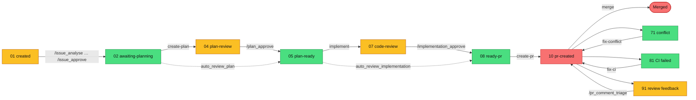

# Development Process

You decide scope and merge; everything else can run unattended; failures come back to you as labelled issues.

mcp-coder turns GitHub issues into reviewed pull requests with LLM sessions; see the [README](../../README.md) for what it is and why.

Dashed edges: review can run headless (`review-plan` / `review-implementation`) when `auto_review_plan` / `auto_review_implementation` is on.

Legend: red = human required (merge, 10); yellow = human or supervisor skill (01, 04, 07, 91); green = fully automated (coordinator / vscodeclaude / Jenkins) (02, 05, 08, 71, 81).

Renders on GitHub. Full state machine incl. failure labels: [workflow matrix](github_Issue_Workflow_Matrix.html).

## Processes

| Process | Trigger label | Actor | Slash commands | Doc |
|---|---|---|---|---|
| Issue discussion | `status-01:created` | Human or supervisor skill | `/issue_analyse`, `/discuss`, `/issue_update`, `/issue_create`, `/issue_approve`, `/issue_analyse_supervisor` | [issue-discussion](processes/issue-discussion.md) |
| Plan creation | `status-02:awaiting-planning` | Automated (`create-plan`) | none | [plan-creation](processes/plan-creation.md) |
| Plan review | `status-04:plan-review` | Human or supervisor skill | `/plan_review_supervisor`, `/plan_review`, `/discuss`, `/plan_update`, `/commit_push`, `/plan_approve`, `/issue_approve` | [plan-review](processes/plan-review.md) |
| Implementation | `status-05:plan-ready` | Automated (`implement`) | `/implementation_finalise`, `/commit_push`, `/check_branch_status` | [implementation](processes/implementation.md) |
| Code review | `status-07:code-review` | Human or supervisor skill | `/implementation_review_supervisor`, `/implementation_review`, `/discuss`, `/implementation_approve`, `/implementation_needs_rework`, `/implementation_new_tasks`, `/implementation_finalise`, `/commit_push`, `/issue_approve` | [code-review](processes/code-review.md) |
| PR creation | `status-08:ready-pr` | Automated (`create-pr`) | none | [pr-creation](processes/pr-creation.md) |
| PR merge | `status-10:pr-created` | Human | `/check_branch_status` | [pr-merge](processes/pr-merge.md) |
| PR follow-up | `status-71`, `status-81`, `status-91` | Automated (71, 81); human or supervisor skill (91) | `/pr_comment_triage`, `/check_branch_status`, `/rebase` | [pr-follow-up](processes/pr-follow-up.md) |
| Automated review | `status-14`, `status-17` (with `auto_review_plan` / `auto_review_implementation`) | Automated (`review-plan`, `review-implementation`) | `/check_branch_status`, `/implementation_finalise` | [automated-review](processes/automated-review.md) |
| Failure handling | any failure label | Human or supervisor skill | `/check_branch_status` | [failure-handling](processes/failure-handling.md) |

## Links

- [Claude Code Cheat Sheet](claude_cheat_sheet.md)
- [Label Setup](../getting-started/label-setup.md) (prerequisite)
- [Workflow Matrix](github_Issue_Workflow_Matrix.html)
