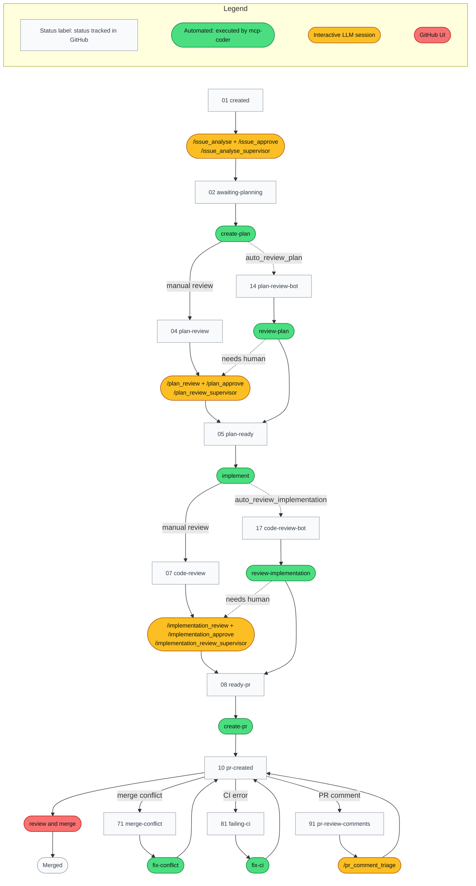

# Development Process

You decide scope and merge; everything else can run unattended; failures come back to you as labelled issues.

mcp-coder turns GitHub issues into reviewed pull requests with LLM sessions; see the [README](../../README.md#why-a-structured-process) for what it is and why.

After `create-plan` and `implement`, the review runs in one of two ways:

- **Interactive** (default): you work in an LLM session.
- **Automated** (dashed): `review-plan` / `review-implementation`, only if `auto_review_plan` / `auto_review_implementation` is on. If it needs a human, it hands over to the interactive review.

**Interactive LLM sessions** are you working with the LLM, step by step or through a supervisor skill. `mcp-coder vscodeclaude launch` opens them, but only for issues **assigned to you** (the GitHub user your token authenticates as) and sitting at a human-action label. An unassigned issue gets no session ([details](../coordinator-vscodeclaude.md#issue-selection)).

`/plan_review` and `/implementation_review` start a step-by-step session with the LLM (with `/discuss` and the update commands).

`/plan_review_supervisor` and `/implementation_review_supervisor` run the review through subagents and stop at "ready for approval".

Either way, the stage ends with `/plan_approve` or `/implementation_approve`.

`/issue_analyse_supervisor` works the same way for the issue. It runs the analysis through subagents and escalates scope and requirements questions to you. It can approve (→ 02) itself once no questions remain; otherwise approve with `/issue_approve`.

Full state machine incl. failure labels: [workflow matrix](https://htmlpreview.github.io/?https://github.com/MarcusJellinghaus/mcp_coder/blob/main/docs/processes-prompts/github_Issue_Workflow_Matrix.html).

## Processes

| Process | Trigger label | Actor | Slash commands | Doc |
|---|---|---|---|---|
| Issue discussion | `status-01:created` | Interactive LLM session | `/issue_analyse`, `/discuss`, `/issue_update`, `/issue_create`, `/issue_approve`, `/issue_analyse_supervisor` | [issue-discussion](processes/01-issue-discussion.md) |
| Plan creation | `status-02:awaiting-planning` | Automated (`create-plan`) | none | [plan-creation](processes/02-plan-creation.md) |
| Plan review | `status-04:plan-review` | Interactive LLM session | `/plan_review_supervisor`, `/plan_review`, `/discuss`, `/plan_update`, `/commit_push`, `/plan_approve` | [plan-review](processes/04-plan-review.md) |
| Implementation | `status-05:plan-ready` | Automated (`implement`) | `/implementation_finalise`, `/commit_push`, `/check_branch_status` | [implementation](processes/05-implementation.md) |
| Code review | `status-07:code-review` | Interactive LLM session | `/implementation_review_supervisor`, `/implementation_review`, `/discuss`, `/implementation_approve`, `/implementation_needs_rework`, `/implementation_new_tasks`, `/implementation_finalise`, `/commit_push` | [code-review](processes/07-code-review.md) |
| PR creation | `status-08:ready-pr` | Automated (`create-pr`) | none | [pr-creation](processes/08-pr-creation.md) |
| PR merge | `status-10:pr-created` | GitHub UI | `/check_branch_status` | [pr-merge](processes/10-pr-merge.md) |
| PR follow-up | `status-71`, `status-81`, `status-91` | Automated (71, 81); interactive LLM session (91) | `/pr_comment_triage`, `/check_branch_status`, `/rebase` | [pr-follow-up](processes/71-pr-follow-up.md) |
| Automated plan review | `status-14` (with `auto_review_plan`) | Automated (`review-plan`) | `/check_branch_status` | [automated-plan-review](processes/14-automated-plan-review.md) |
| Automated code review | `status-17` (with `auto_review_implementation`) | Automated (`review-implementation`) | `/check_branch_status`, `/implementation_finalise` | [automated-code-review](processes/17-automated-code-review.md) |
| Failure handling | any failure label | Interactive LLM session | `/check_branch_status` | [failure-handling](processes/failure-handling.md) |

## Links

- [Claude Code Cheat Sheet](claude_cheat_sheet.md)
- [Label Setup](../getting-started/label-setup.md) (prerequisite)
- [Workflow Matrix](https://htmlpreview.github.io/?https://github.com/MarcusJellinghaus/mcp_coder/blob/main/docs/processes-prompts/github_Issue_Workflow_Matrix.html)
